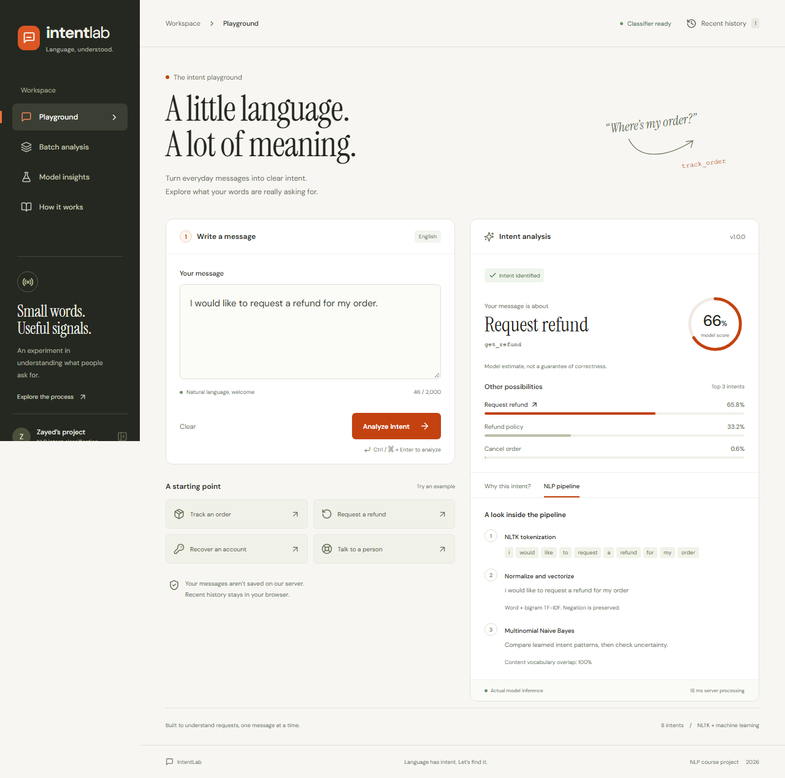

# IntentLab | NLP-Based User Intent Classification

**Zayed Bin Hassan | ASI23CA064**  
NLP course project

An interactive customer-support intent classifier. NLTK tokenizes English customer-support messages, TF-IDF represents words and phrases, and an offline-trained classifier predicts one of eight intents.

Start with [START_HERE_ZAYED.md](START_HERE_ZAYED.md) for beginner instructions.

## Demo and report

**Live demo:** Deployment to Vercel is pending. The deployed URL will be added after Zayed deploys the project and its UI and API are verified.

- [Course project report (PDF)](report/Zayed_Bin_Hassan_IntentLab_Course_Project_Report.pdf)
- [Editable project report (Word)](report/Zayed_Bin_Hassan_IntentLab_Course_Project_Report.docx)
- [Beginner setup guide](START_HERE_ZAYED.md)
- [Demo and viva notes](docs/DEMO_AND_VIVA.md)



## Features

- Responsive playground with ranked predictions, actual feature evidence and NLTK processing steps.
- Uncertainty outcome for low scores, ambiguous rankings or poor content-vocabulary overlap.
- Up to 25 messages per batch, downloadable CSV with formula injection protection.
- Ten recent individual analyses stored only in the current browser, with a clear-history control.
- Measured model comparison, per-intent metrics, confusion matrix and methodology pages.
- Python Vercel Functions; no API key, runtime model training, or downloaded NLTK corpora.
- Fonts bundled locally; keyboard shortcut, visible focus states, reduced-motion support.

## Local setup

Use Node.js 22 LTS and Python 3.12 (recommended; development was also tested with Python 3.13.5). Clone this repository, then install the dependencies:

```powershell
git clone https://github.com/ZayedBH/NLP_Intent_Classification.git
cd NLP_Intent_Classification
```

From the project folder:

```powershell
python -m venv .venv
.venv\Scripts\python.exe -m pip install -r requirements-dev.txt
npm ci
```

Open two terminals in the same folder:

```powershell
# Terminal 1: Python API
.venv\Scripts\python.exe scripts/dev_server.py
```

```powershell
# Terminal 2: frontend
npx vite --host 127.0.0.1
```

Open **http://127.0.0.1:5173/**. Keep both terminals running. The frontend proxies `/api` to port 8000. If Python dependencies are already installed in your active environment, `npm run dev` starts both processes together.

Opening `index.html` directly or using only `npm run preview` does not start the Python API. `npm run preview` serves the production frontend only.

## Deploy to Vercel

1. Import `ZayedBH/NLP_Intent_Classification`. Keep these files in the repository: `models/intent-model.joblib`, `intentlab/`, `api/`, `public/model-report.json`, `public/data-license.txt`, `requirements.txt`, `.python-version`, `package-lock.json`, and `vercel.json`.
2. In Vercel, choose **Add New → Project**, import that repository, and select the project root.
3. Use the **Vite** framework preset, `npm run build` as the build command and `dist` as the output directory. The included configuration supplies these settings.
4. Deploy. Vercel discovers `api/classify.py` and `api/health.py` as Python Functions. No environment variables or external AI credentials are required.
5. Open `/api/health` on the deployed URL. It must return `{"status":"ready",...}`. Then analyze an example in the UI and try batch analysis.

Do not set `dist` as the source/root directory: the Python API and saved model must remain in the deployment source. If model imports fail, check function logs and confirm all model/runtime files were included. The first request can take longer while a new function initializes.

**Hosted Vercel deployment has not been performed.** The actual HTTP handler, local Vite proxy, desktop/mobile flows, and production frontend build are verified locally. The Vercel source configuration is prepared for Zayed to deploy; hosted packaging and cold-start behavior need validation on his deployment.

## Model and data

Bitext's public customer-support dataset is **hybrid synthetic**. This project uses an eight-intent subset: track order, cancel order, refund policy, request refund, payment issue, account access (password recovery), get invoice and contact support (human agent). It does not recognize every customer-support request.

The original dataset lacks dedicated return-item and product-information labels, so refund policy and invoice were used instead of inventing labels.

After exact-message deduplication, there are **6,989 messages**: 4,851 training, 1,083 validation and 1,055 test. Entity/number-normalized templates and within-intent char-trigram cosine similarity of at least 0.92 determine groups before a stratified 70/15/15 group split (seed 42). Related templates may still remain; original seed IDs are unavailable. TF-IDF fitting uses only training messages.

| Model | Validation macro F1 | Test accuracy | Test macro F1 |
| --- | ---: | ---: | ---: |
| Logistic Regression | 0.9832 | 99.5261% | 0.9933 |
| Multinomial Naive Bayes | 0.9905 | 99.6209% | 0.9940 |

Naive Bayes was selected using validation macro F1. Test scores are final reporting metrics, not the selection criterion. Four held-out errors involve misspelled cancellation requests; see `data/test-errors.json`.

The probability threshold (0.40) was selected on in-domain validation data to maximize coverage among candidate thresholds meeting at least 97% accepted accuracy. A 0.15 lead, 35% content-vocabulary overlap and minimum three tokens are additional heuristics, not a validated open-set classifier. Probabilities are uncalibrated estimates.

For Naive Bayes, evidence is **TF-IDF multiplied by the target class log-likelihood minus the mean log-likelihood of other classes**. Positive values support that candidate; negative values oppose it. It is not a percentage or causal explanation. Logistic Regression uses weighted class coefficients if selected in a later training run.

Full report: `public/model-report.json`. Data source revision and SHA-256 hashes: `data/provenance.json`. Original data license: `data/LICENSE-BITEXT.txt` (**CDLA-Sharing-1.0**). The subset and splits are provided under that same data license; retain the notice when sharing. Attribution belongs to Bitext for the dataset.

## Reproduce training

```powershell
.venv\Scripts\python.exe scripts/download_data.py
.venv\Scripts\python.exe scripts/train.py
```

The full original CSV is not tracked in this repository. The downloader retrieves the pinned public revision into `data/raw/bitext.csv`; the committed subset and partitions document the model dataset. Training exports the saved model, actual partitions, error analysis and UI report. Training takes place offline from the API. Restart the Python server after retraining so its cached model reloads.

## Tests

```powershell
.venv\Scripts\python.exe -m pytest -q
npm test
npm run build
npx playwright install chromium
npm run test:e2e
```

Playwright starts the local stack if port 5173 is not already in use. For a virtual environment, start the two servers manually first using the local setup instructions. Automated checks supplement manual visual/keyboard review; they do not prove complete accessibility or generalization.

## API

`GET /api/health` reports model readiness and version.

`POST /api/classify` with `Content-Type: application/json`:

```json
{ "texts": ["Where is my order?"] }
```

Returns `{ "results": [...] }` in input order. Each analysis contains original text, status, label, model score, three predictions, tokens, normalized text, signed evidence, model version and server processing time. Limits: 1–25 messages, 2,000 characters per message, 220 KB request body. Invalid batches fail atomically with a client error. Processing time excludes network latency.

## Privacy and limitations

No message bodies are written by the API to a database or application log. Browser history includes message text, so avoid pasting private information on a shared machine. Clear history to remove locally saved analyses. Hosting providers may retain their own operational request metadata. The application has no login or server-side analytics.

English only; single intent per message; no sentiment analysis, entity extraction or generated support replies. Synthetic-data scores can substantially overestimate real-world performance. Domain-overlap checks can miss unsupported messages that use familiar support terms. This is an academic demonstration, not an automated customer-service decision system.

## Layout

`src/` contains the React UI; `intentlab/` contains preprocessing, inference and the shared HTTP handler; `api/` contains Vercel entrypoints; `scripts/` contains data, training and local server tools; `models/` contains the trusted saved artifact; `data/` contains provenance, license, subset, partitions and mistakes; `docs/` contains the plan, demo notes and verification record.


## Project author

**Zayed Bin Hassan**  
Registration number: **ASI23CA064**

Dataset credit and redistribution terms remain with Bitext under [CDLA-Sharing-1.0](data/LICENSE-BITEXT.txt).
